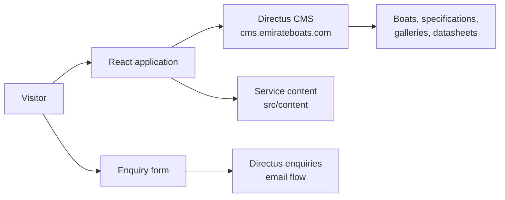

# Emirates Boats | Fleet & Services

> The production website for **Emirates Boats LLC**, built as a portfolio project by [Rehan Rathnaweera](https://www.linkedin.com/in/rehanratnaweera).

Emirates Boats is a Dubai-based marine manufacturer. Version 2 of the site, live at [emirateboats.com](https://emirateboats.com), presents the company, its fleet and its service department as a quiet, photography-led experience. Fleet content is loaded live from the CMS; service content comes from the yard's own service portfolios.

## Status

| Part | State |
| --- | --- |
| Website v2 (fleet, boat pages, services, enquiries) | **Live** — deployed from `main` |
| Interactive 3D boat configurator (Three.js) | **In development** — not part of the current site |

The 3D configurator was shipped with version 1 of the site and was taken out of `main` for the v2 release (commit `1406067`). It is being rebuilt separately and will return to the site once it is ready. Until then, visitors choose colors with the painting page's swatch library and send their configuration through the enquiry form.

## What the site does

- Loads boat records, specifications, galleries and datasheets from a Directus CMS.
- Gives every boat its own page: lead photograph, headline figures, specification, datasheet download and a photo gallery with a lightbox.
- Shows a caption on a gallery photo when its file has a title or description in Directus.
- Lists the twelve services of the service department, with three in depth:
  - **Painting** — a finish viewer in two lights and the 240-color Cromax® swatch library; a chosen color is carried into the enquiry.
  - **Tooling Center** — the 5-axis machine envelope and the twelve steps from CAD file to mold.
  - **Hydraulic swim platforms** — the platforms the yard supplies and how they are installed.
- Saves enquiries to the Directus `enquiries` collection, where a flow emails them to the yard, pre-filled with the boat or service the visitor was reading about.
- Publishes search and sharing metadata (title, description, canonical URL, Open Graph and Twitter cards), a `robots.txt` and a `sitemap.xml`.
- Reports page views to Google Analytics.
- Builds into a small static bundle served by Nginx inside a Docker image.

## Pages

There is no router library and no server-side routing. Pages are selected by a query parameter, so the site works from any static host:

| URL | Page |
| --- | --- |
| `/` | Home — sections `#fleet`, `#services`, `#craft`, `#contact` |
| `/?model=<slug>` | A boat, for example `/?model=eb-63` |
| `/?service=painting` | Marine painting and refinishing |
| `/?service=tooling` | Tooling Center, 5-axis CNC |
| `/?service=hydraulics` | Hydraulic swim platforms |

A boat's slug is its name in lower case with spaces replaced by hyphens. `src/router.ts` intercepts ordinary same-site links, so pages are linked with plain `<a href>` elements.

When a boat or service page is added, also add it to `public/sitemap.xml`.

## Product flow



The browser requests the fleet once on load. `src/cms.ts` turns the Directus response into a typed `BoatModel`, so the rest of the UI works with a stable shape. If the request fails, the fleet section and boat pages say so and point to the enquiry form; the service pages do not depend on the CMS.

## Tech stack

| Area | Technology |
| --- | --- |
| UI | React 19, TypeScript |
| Build tool | Vite 8 |
| Styling | Hand-written CSS with theme tokens (Tailwind CSS 4 supplies the reset) |
| Type | Marcellus (display), Jost (text) |
| Content | Directus REST API, plus typed content modules for services |
| Enquiries | Directus REST API (`enquiries` collection, email flow) |
| Analytics | Google Analytics 4 (gtag), injected at build time |
| Production server | Nginx on Alpine Linux |
| Tooling | GitHub Actions, pnpm, Docker (GHCR), Commitlint, Husky, oxfmt |

## Repository map

```text
.
├── src/
│   ├── App.tsx                 # Fleet loading, page selection, titles, scroll position
│   ├── router.ts               # Query-parameter routes and link handling
│   ├── cms.ts                  # Directus client, image URLs and CMS-to-UI mapping
│   ├── fleetFacts.ts           # Headline figures derived from a boat's specification
│   ├── useScrollReveal.ts      # Scroll-reveal motion
│   ├── index.css               # Design tokens and every component style
│   ├── pages/                  # Home, Model, Painting, Tooling, Hydraulics, NotFound
│   ├── components/             # Nav, footer, hero video, gallery, lightbox, enquiry form …
│   ├── content/                # Company details, services, service pages, paint colors
│   └── assets/services/        # Service photography (WebP)
├── public/                     # robots.txt and sitemap.xml
├── .github/workflows/
│   └── release.yml             # Builds the site and publishes the Docker image
├── .eb/make/site.json          # Site title, description, URL, social image, analytics ID
├── .husky/                     # Pre-commit build and commit message linting
├── dockerfile                  # Nginx image for the compiled dist/ directory
├── vite.config.ts              # Vite, Tailwind, metadata injection and server configuration
└── package.json                # Scripts and dependency manifest
```

## Running locally

### Requirements

- Node.js 22 or newer
- pnpm `12.0.0-rc.11` (the version declared by `package.json`)
- Network access to the Directus CMS for the fleet to load

```bash
pnpm install
pnpm run dev
```

The development server listens on `http://localhost:3000` and binds to `0.0.0.0`, which also makes it reachable from a local device or container.

Useful commands:

```bash
pnpm run build       # Create the production bundle in dist/
pnpm run preview     # Serve the production bundle locally
pnpm run format      # Format supported source files with oxfmt
```

There is no test or lint script yet. The pre-commit hook runs the production build as the application check, and the commit-msg hook enforces [Conventional Commits](https://www.conventionalcommits.org/) with Commitlint.

## Editing content

### Boats — Directus

The frontend reads published boats, in their Directus sort order, from:

```text
https://cms.emirateboats.com/items/boats
```

Each boat record can provide:

- Identity: `name`, `tagline`
- Editorial content: `description` (blank lines separate paragraphs)
- Technical data: `length`, `beam`, `displacement`, `range`, `power`, `speed`, `capacity`, `construction`
- Gallery: `gallery`
- Downloadable document: `datasheet_file`

Empty specification fields are left out of the page. The headline figures (combined output, top speed, range, length) are worked out from `power`, `speed`, `range` and `length`, so write them as a number followed by a unit — for example `6 x Mercury 500R`, `82 mph MAX / 60 mph Cruise`, `1,200 nm`, `63 ft / 19.2 m`.

Gallery photographs:

- **Captions.** Give a file a **Title** and/or **Description** in the Directus file library and it appears as the photo's caption on the tile and in the lightbox. A title that is only the file name is ignored.
- **Lead photograph.** The first gallery photo that Directus can resize is used as the boat's lead image on the home page and its own page. Reorder the gallery to change it.
- **Large originals.** Directus can only resize a photo when it knows the file's width and height. Photos without those are kept out of the page grid and offered in the lightbox as full-resolution originals. Re-uploading them fixes this.

The CMS must allow browser requests from the deployed site.

### Services and company details — repository

| File | Holds |
| --- | --- |
| `src/content/site.ts` | Address, phone numbers, service desk contact, boat show notice, build stages |
| `src/content/services.ts` | The twelve services and the service process |
| `src/content/servicePages.ts` | Painting, Tooling Center and hydraulics page content |
| `src/content/paintColors.ts` | The 240-color swatch library |

The boat show notice on the home page hides itself once the show's end date in `site.ts` has passed.

### Languages

English is the only language anyone writes. The site opens in the visitor's saved choice, or the first browser language it supports, and falls back to English. The selector in the nav switches language and remembers the choice.

- Text in components goes through `t("…")` from `src/i18n`. Values like `{name}` are passed as `t("Discover the {name}", { name })`. Text that contains a link uses `rich("… <link>contact the yard</link> …", { link: … })`.
- Text in `src/content/` is wrapped in `msg("…")` so the translation script can find it, then shown with `t(value)`.
- `pnpm translate` sends new or changed English text to Gemini and writes the results to `src/i18n/locales/<code>.json`. Run it locally after editing copy and commit the JSON. Text that is already translated is never sent again, so hand corrections in the JSON are kept until the English changes.
- The key lives in `.env`, which is not committed: copy `.env.example` to `.env` and set `GEMINI_API_KEY` to a key from [Google AI Studio](https://aistudio.google.com/apikey). CI never translates, so the repository needs no secret.
- The script uses three models in order of preference, `gemini-4-hydrogen`, `gemini-3.8-flash` and `gemini-3.6-flash`, and keeps each one within its free-tier requests per minute and per day. A model that is overloaded or out of requests is skipped for the next one. When all three are out for the day, the script stops; finished batches are saved, so run it again after midnight Pacific time. Requests sent today are counted in `.cache/gemini-usage.json`. Set `GEMINI_MODELS` in `.env` to change the models or their order, and update `MODEL_LIMITS` in `scripts/translate.mjs` if Google changes the limits.
- `pnpm run build` reports any text without a translation. That text shows in English until it is translated.
- Add a language by adding it to `src/i18n/languages.json` and running `pnpm translate`.
- Boat content from Directus, the paint swatch names and the addresses stay in English.

### Site metadata and analytics

`.eb/make/site.json` holds the page title, meta description, canonical site URL, Open Graph image and Google Analytics measurement ID. A Vite plugin in `vite.config.ts` writes these into `index.html` at build time; remove `googleAnalyticsId` to build without analytics.

## Production delivery

Pushing to `main` triggers [.github/workflows/release.yml](.github/workflows/release.yml), which:

1. Installs the locked dependency tree with pnpm.
2. Builds the Vite application into `dist/`.
3. Builds and publishes `ghcr.io/rehanratnaweera/emiratesboats_website:latest`.

There are no versioned releases or changelog; every push to `main` replaces the `latest` image.

The Docker image uses Nginx to serve the compiled static files:

```bash
pnpm run build
docker build -f dockerfile -t emirates-boats .
docker run --rm -p 8080:80 emirates-boats
```

Then open `http://localhost:8080`.

Vite also supports an optional public path through `eb_PUBLIC_URL`. The dev and preview ports can be changed with `PORT`.

## Implementation notes

- Directus resizes and converts photographs to WebP on request; pages ask for the size they display.
- The app uses an `AbortController` when loading fleet data, preventing stale requests during unmount.
- Scroll position is kept per page, so the browser's back button returns to where the visitor was.
- Scroll-reveal motion and the hero video respect the visitor's reduced-motion setting.
- The enquiry form includes browser validation, an error message when Directus rejects the submission, submission state, and a success state.

## Roadmap

- Finish the interactive 3D boat configurator and bring it back to the site.

## License and content

The source is published for portfolio and demonstration purposes. Emirates Boats branding, copy, imagery, and CMS content belong to their respective owners and should not be reused without permission.
