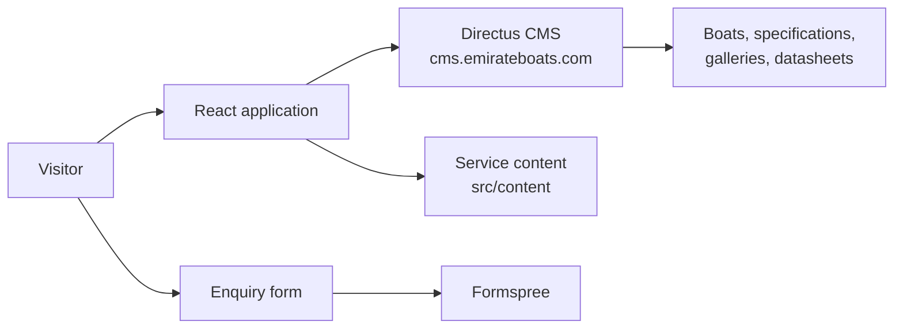

# Emirates Boats | Fleet & Services

> A production-facing website for **Emirates Boats LLC**, built as a portfolio project by [Rehan Rathnaweera](https://www.linkedin.com/in/rehanratnaweera).

Emirates Boats is a Dubai-based marine manufacturer. Version 2 of the site presents the company, its fleet and its service department as a quiet, photography-led experience. Fleet content is live from the CMS; service content comes from the yard's own service portfolios.

The earlier site, with the interactive Three.js boat configurator, is archived on the `v1-3d-configurator` branch. That branch does not build Docker images or publish releases.

## What the site does

- Loads boat records, specifications, galleries and datasheets from a Directus CMS.
- Gives every boat its own page: lead photograph, headline figures, specification, datasheet download and a photo gallery with a lightbox.
- Shows a caption on a gallery photo when its file has a title or description in Directus.
- Lists the twelve services of the service department, with three in depth:
  - **Painting** — a finish viewer in two lights and the 240-color swatch library; a chosen color is carried into the enquiry.
  - **Tooling Center** — the 5-axis machine envelope and the twelve steps from CAD file to mold.
  - **Hydraulic swim platforms** — the platforms the yard supplies and how they are installed.
- Sends enquiries through Formspree, pre-filled with the boat or service the visitor was reading about.
- Builds into a small static bundle served by Nginx inside a Docker image.

## Pages

There is no router library and no server-side routing. Pages are selected by a query parameter so the site works from any static host:

| URL | Page |
| --- | --- |
| `/` | Home — sections `#fleet`, `#services`, `#craft`, `#contact` |
| `/?model=<slug>` | A boat, for example `/?model=eb-63` |
| `/?service=painting` | Marine painting and refinishing |
| `/?service=tooling` | Tooling Center, 5-axis CNC |
| `/?service=hydraulics` | Hydraulic swim platforms |

A boat's slug is its name in lower case with spaces replaced by hyphens. `src/router.ts` intercepts ordinary same-site links, so pages are linked with plain `<a href>` elements.

## Product flow



The browser requests the fleet once on load. `src/cms.ts` turns the Directus response into a typed `BoatModel`, so the rest of the UI works with a stable shape. If the request fails, the fleet section and boat pages say so and point to the enquiry form; the service pages do not depend on the CMS.

## Tech stack

| Area | Technology |
| --- | --- |
| UI | React 19, TypeScript |
| Build tool | Vite 8 |
| Styling | Hand-written CSS with theme tokens (Tailwind CSS 4 supplies the reset) |
| Type | Marcellus (display), Jost (text) |
| Content | Directus REST API, plus typed content modules for services |
| Enquiries | Formspree React |
| Production server | Nginx on Alpine Linux |
| Release tooling | GitHub Actions, pnpm, Docker (GHCR), Commitlint, Husky |

## Repository map

```text
.
├── src/
│   ├── App.tsx                 # Fleet loading, page selection, titles, scroll position
│   ├── router.ts               # Query-parameter routes and link handling
│   ├── cms.ts                  # Directus client, image URLs and CMS-to-UI mapping
│   ├── fleetFacts.ts           # Headline figures derived from a boat's specification
│   ├── index.css               # Design tokens and every component style
│   ├── pages/                  # Home, Model, Painting, Tooling, Hydraulics, NotFound
│   ├── components/             # Nav, footer, hero video, gallery, lightbox, enquiry form …
│   ├── content/                # Company details, services, service pages, paint colors
│   └── assets/services/        # Service photography (WebP)
├── .github/workflows/
│   └── release.yml             # Build, publish, package, and release automation
├── .eb/make/site.json          # Site metadata used by the Vite config
├── dockerfile                  # Nginx image for the compiled dist/ directory
├── vite.config.ts              # Vite, Tailwind, metadata, and server configuration
└── package.json                # Scripts and dependency manifest
```

## Running locally

### Requirements

- Node.js 22 or newer
- pnpm `12.0.0-rc.11` (the version declared by `package.json`)
- Network access to the Directus CMS for the fleet to load

```bash
pnpm install
pnpm run dev
```

The development server listens on `http://localhost:3000` and binds to `0.0.0.0`, which also makes it reachable from a local device or container.

Useful commands:

```bash
pnpm run build       # Create the production bundle in dist/
pnpm run preview     # Serve the production bundle locally
pnpm run format      # Format supported source files with oxfmt
```

There is currently no test or lint script in `package.json`; the pre-commit hook runs the production build as the available application check.

## Editing content

### Boats — Directus

The frontend reads published boats, in their Directus sort order, from:

```text
https://cms.emirateboats.com/items/boats
```

Each boat record can provide:

- Identity: `name`, `tagline`
- Editorial content: `description` (blank lines separate paragraphs)
- Technical data: `length`, `beam`, `displacement`, `range`, `power`, `speed`, `capacity`, `construction`
- Gallery: `gallery`
- Downloadable document: `datasheet_file`

Empty specification fields are left out of the page. The headline figures (combined output, top speed, range, length) are worked out from `power`, `speed`, `range` and `length`, so write them as a number followed by a unit — for example `6 x Mercury 500R`, `82 mph MAX / 60 mph Cruise`, `1,200 nm`, `63 ft / 19.2 m`.

Gallery photographs:

- **Captions.** Give a file a **Title** and/or **Description** in the Directus file library and it appears as the photo's caption on the tile and in the lightbox. A title that is only the file name is ignored.
- **Lead photograph.** The first gallery photo that Directus can resize is used as the boat's lead image on the home page and its own page. Reorder the gallery to change it.
- **Large originals.** Directus can only resize a photo when it knows the file's width and height. Photos without those are kept out of the page grid and offered in the lightbox as full-resolution originals. Re-uploading them fixes this.

The CMS must allow browser requests from the deployed site.

### Services and company details — repository

| File | Holds |
| --- | --- |
| `src/content/site.ts` | Address, phone numbers, service desk contact, boat show notice, build stages |
| `src/content/services.ts` | The twelve services and the service process |
| `src/content/servicePages.ts` | Painting, Tooling Center and hydraulics page content |
| `src/content/paintColors.ts` | The 240-color swatch library |

The boat show notice on the home page hides itself once the show's end date in `site.ts` has passed.

## Production delivery

Pushing to `main` triggers [.github/workflows/release.yml](.github/workflows/release.yml), which:

1. Installs the locked dependency tree with pnpm.
2. Builds the Vite application into `dist/`.
3. Builds and publishes `ghcr.io/rehanratnaweera/emiratesboats_website:latest`.

The Docker image uses Nginx to serve the compiled static files:

```bash
pnpm run build
docker build -f dockerfile -t emirates-boats .
docker run --rm -p 8080:80 emirates-boats
```

Then open `http://localhost:8080`.

Vite also supports an optional public path through `eb_PUBLIC_URL`. The dev and preview ports can be changed with `PORT`.

## Implementation notes

- Directus resizes and converts photographs to WebP on request; pages ask for the size they display.
- The app uses an `AbortController` when loading fleet data, preventing stale requests during unmount.
- Scroll position is kept per page, so the browser's back button returns to where the visitor was.
- Scroll-reveal motion and the hero video respect the visitor's reduced-motion setting.
- The enquiry form includes browser validation, Formspree validation errors, submission state, and a success state.

## Project status

This is an actively evolving portfolio representation of a live client-facing site. CMS content, external media URLs, Formspree configuration, and deployment credentials are intentionally kept outside the repository where possible.

## License and content

The source is published for portfolio and demonstration purposes. Emirates Boats branding, copy, imagery, and CMS content belong to their respective owners and should not be reused without permission.
